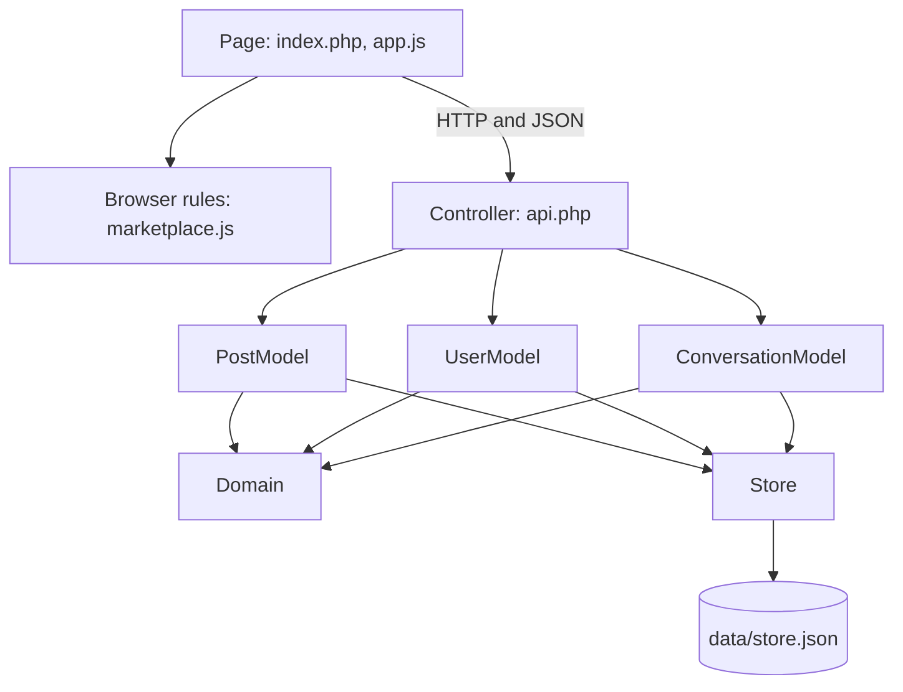

# CRC Diagram — Campus Community Marketplace

Each card lists one component's responsibilities and collaborators. The PHP code uses plain functions, so each card describes a file rather than a class.

## Collaboration overview

## Page (`index.php`, `assets/app.js`)

| Responsibilities | Collaborators |
| --- | --- |
| Render the Marketplace, Moving help, My posts, Messages, and Profile views | Browser rules |
| Collect form input and show errors | Controller |
| Open sign-in when a signed-out user needs an account | Controller |
| Check for new messages while **Messages** is open | Controller |

## Browser rules (`assets/marketplace.js`)

| Responsibilities | Collaborators |
| --- | --- |
| Search and filter listings | Page |
| Update post and conversation lists | Page |
| Decide who can respond to a post | Page |
| Reset post forms so a new post never reuses an edited post's ID | Page |

## Controller (`api.php`)

| Responsibilities | Collaborators |
| --- | --- |
| Start, remember, and end sessions | UserModel |
| Require sign-in for protected requests | PostModel |
| Route requests to the correct model | ConversationModel |
| Translate errors into HTTP status codes and JSON | Domain |

## PostModel (`src/PostModel.php`)

| Responsibilities | Collaborators |
| --- | --- |
| List listings and help posts with their owners | Domain |
| Create, update, and remove posts | Store |
| Mark listings as sold | |
| Allow changes only by the post owner | |

## UserModel (`src/UserModel.php`)

| Responsibilities | Collaborators |
| --- | --- |
| Register accounts with unique SCU emails | Domain |
| Hash and check passwords | Store |
| Read and update profiles | |

## ConversationModel (`src/ConversationModel.php`)

| Responsibilities | Collaborators |
| --- | --- |
| Start or reuse a conversation when a user responds to a post | Domain |
| Add messages and list a user's conversations | Store |
| Set default locations and save pickup and drop-off changes | |
| Allow access only to conversation participants | |

## Domain (`src/Domain.php`)

| Responsibilities | Collaborators |
| --- | --- |
| Validate listings, help posts, accounts, profiles, messages, and locations | PostModel |
| Decide SCU verification and build public profiles | UserModel |
| Enforce post ownership, response, and participant rules | ConversationModel |
| Define the errors that the Controller translates | Controller |

## Store (`src/Store.php`)

| Responsibilities | Collaborators |
| --- | --- |
| Read and write `data/store.json` with file locks | PostModel |
| Provide empty collections when data is missing | UserModel |
| Report storage failures | ConversationModel |
