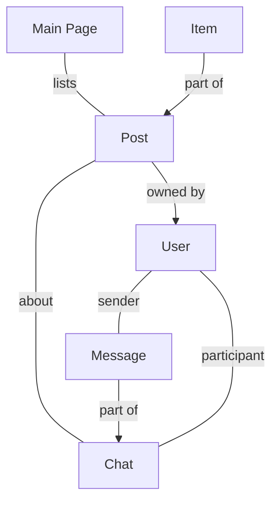

# CRC Diagram — Campus Community Marketplace

These cards match `docs/CRC_DIAGRAM.drawio`. Open that file in [diagrams.net](https://app.diagrams.net) to view or edit the diagram, and update this page in the same change.

## Main Page

| Knows | Does | Collaborators |
| --- | --- | --- |
| Listings and open help posts | Add a new post to the page | Post |
| For Sale / Moving Help tabs | Hide closed help posts | |
| | Badge sold listings | |
| | Show posts by section | |

## User

| Knows | Does | Collaborators |
| --- | --- | --- |
| User ID, name | Sign in and out | Post |
| SCU email | Create, edit, delete posts | Chat |
| Verified SCU status | Start a chat about a post | Message |
| Residence, bio | Update profile | |
| Posts they created | | |
| Chats they belong to | | |

## Post

| Knows | Does | Collaborators |
| --- | --- | --- |
| Post ID | Show item and owner details | User |
| Owner (User) | Update its status | Item |
| Item (For Sale posts) | Open a chat with the owner | Chat |
| Type: For Sale / Moving Help | | Main Page |
| Pickup location | | |
| Drop-off (Moving Help posts) | | |
| Status: available / sold or open / closed | | |

## Item

| Knows | Does | Collaborators |
| --- | --- | --- |
| Stored on its For Sale post | Update its details | Post |
| Description | Give a summary for display | |
| Photos | | |
| Price | | |
| Category, condition | | |

## Message

| Knows | Does | Collaborators |
| --- | --- | --- |
| Message ID | Show sender, text and time | User |
| Sender (User) | Add itself to its chat | Chat |
| Text | | |
| Timestamp | | |
| Chat ID | | |

## Chat

| Knows | Does | Collaborators |
| --- | --- | --- |
| Chat ID | Send a message | User |
| Participants (2 users) | Show message history | Post |
| Post it is about | Save locations | Message |
| List of messages | | |
| Pickup / drop-off locations | | |
