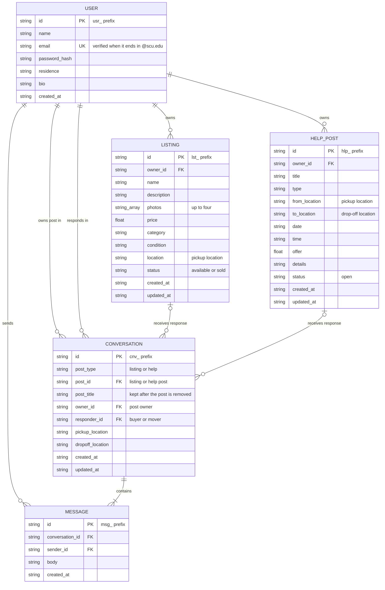

# ER Diagram — Campus Community Marketplace

This diagram shows the records in `data/store.json`. The app stores each entity as a top-level array and links records by ID.

## Rules

- Each post and responder pair has at most one conversation.
- `post_type` decides whether `post_id` points to a listing or a help post.
- Removing a post keeps its conversations, so `post_id` can point to a record that no longer exists.
- `verified` is not stored. The app derives it from `email`.
